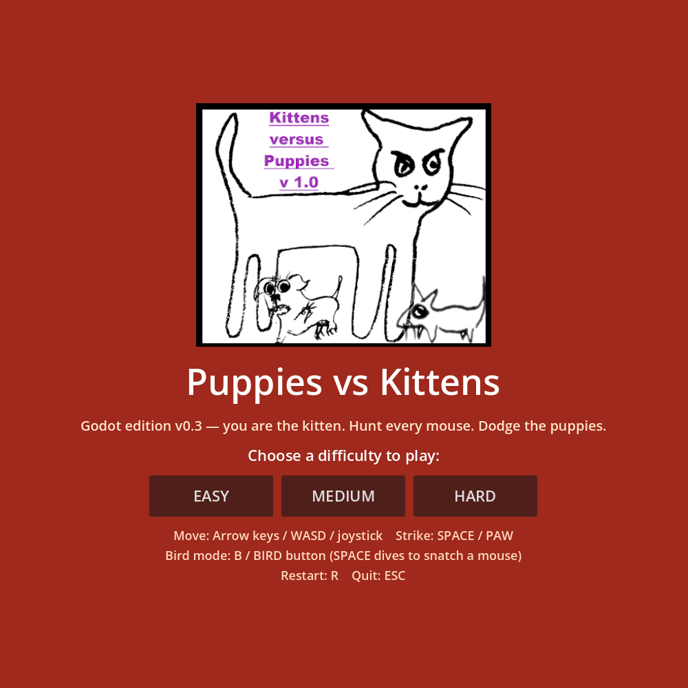
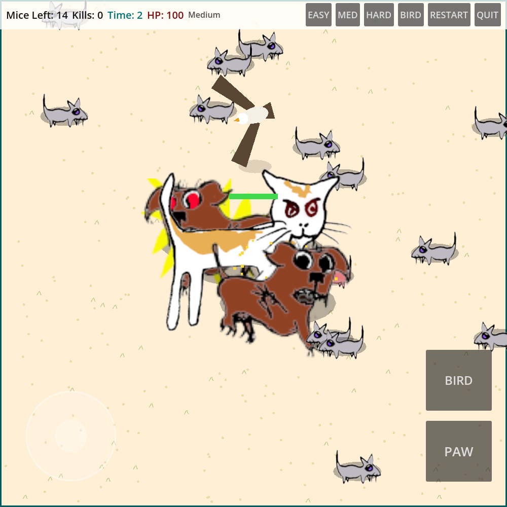
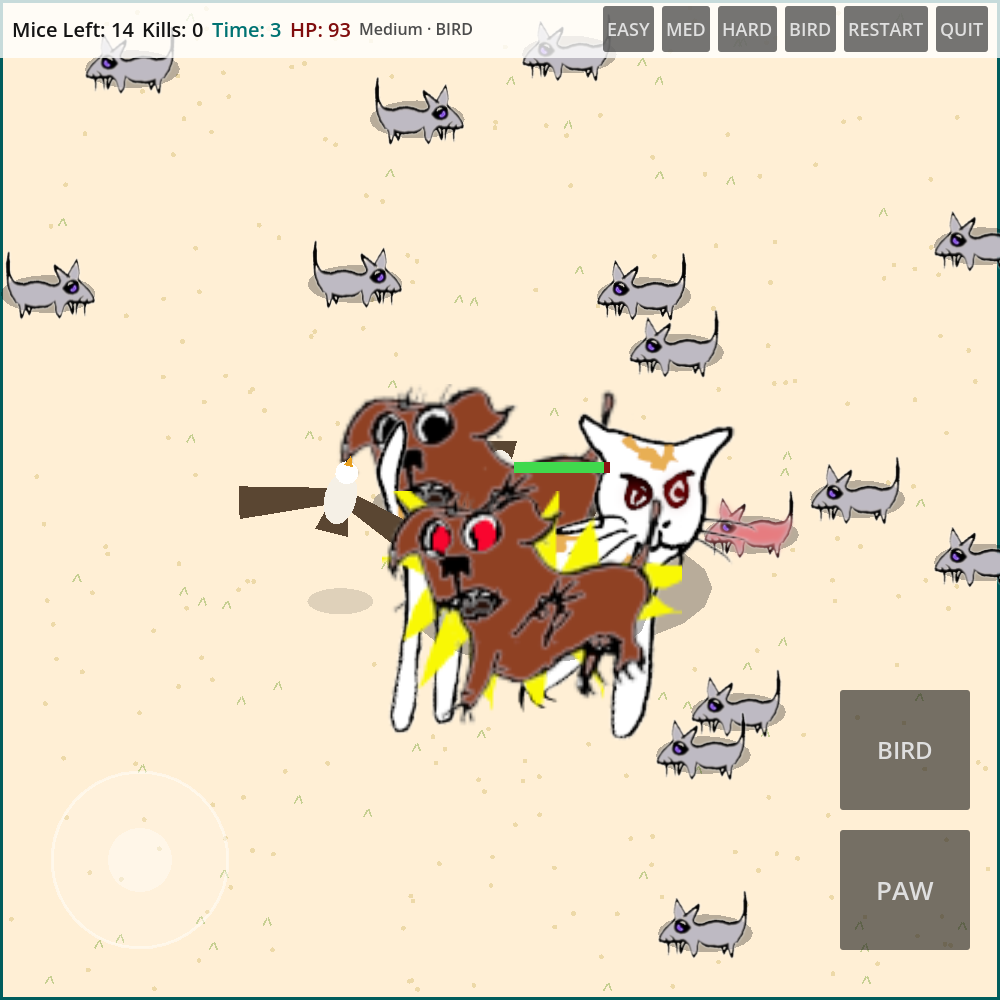

# Puppies vs Kittens — Godot Edition (v0.3)

A Godot 4 revamp of the 2020 JavaFX game preserved in this repository's root
(that original stays frozen as v0.2; nothing there was modified). Same
hand-drawn art, same rules, rebuilt on a data-driven animal system that is
designed to be lifted into **GTA Fredericton** later — plus a bird mode
adapted from GTA Fredericton's own bird mode (TODO #87).

## The game

You are the kitten. Hunt every mouse on the field; the puppies are hunting
*you*, in a loose pack. A paw strike **wounds** a mouse — the wound kills
it 3 seconds later (the original's `timeToLiveAfterHurt`). Puppies that
reach you drain your HP once per second. Catch all the mice to win; lose
all 100 HP, or quit with mice remaining, and you lose.

| Difficulty | Mice | Puppies | Mouse speed | Puppy damage/s |
|---|---|---|---|---|
| Easy   | 7  | 1 | slow   | 5  |
| Medium | 14 | 2 | medium | 7  |
| Hard   | 21 | 3 | fast   | 20 |

Faithful to the Java original (KvPModel.java): spawn counts, puppy chase
model (`step = distance / divisor`, divisors 150/100/50, later puppies
effectively faster), per-second puppy damage, wound-then-die mice, the
papawhip field, HUD semantics (Mice Left / Kills / Time), and the quirk
that the Kills counter is cumulative across rounds within a session.

## Controls

| Action | Keyboard | Touch |
|---|---|---|
| Move | Arrow keys / WASD | Virtual joystick (bottom-left) |
| Paw strike / dive | SPACE | PAW button |
| Bird mode toggle | B | BIRD button |
| Restart round | R | RESTART button |
| Quit to results | ESC | QUIT button |

Difficulty can be switched from the HUD buttons; it restarts the round at
the new difficulty.

## Bird mode

Press **B** (or BIRD) and you possess a bird — the kitten stays in the
world as a wandering NPC, exactly the possession model GTA Fredericton
uses (its human stays in the world as an NPC). The bird climbs to cruise
altitude (its shadow marks the true ground position), flies fast, and
**SPACE dives**: at ground level it snatches at a mouse within reach,
wounding it by the same rule as a paw strike. Puppies cannot reach the
bird while it is airborne. A wild bird NPC also works the field from the
start, circling and occasionally diving at mice. Press B again to return
to the kitten. Design provenance and the porting notes live in
[animal_kit/README.md](animal_kit/README.md).

## Mobile / web

- Display stretch is `canvas_items` with `expand` aspect, so the square
  field letterboxes cleanly on phones in either orientation.
- Touch controls appear automatically on Android/iOS and mobile web.
- Export presets: **Web** (primary) and **Android** (defined; a signed
  build still needs your SDK/keystore configured in the editor).

## Run it

- **Editor:** open this `godot/` folder as a Godot 4.7 project and run.
- **Headless smoke test** (17 state assertions, no display needed):

      godot --headless --path godot -s res://tests/smoke_test.gd

- **Web export:**

      godot --headless --path godot --export-release "Web" build/web/index.html

  then serve `godot/build/web/` with any static file server. The preset
  uses the no-threads variant, so no COOP/COEP headers are required.
  Build output is git-ignored.

## Layout

- `main.gd` — game controller: rounds, difficulty table, HUD, splash and
  results screens, input actions, possession swap, the per-second tick.
- `animal_kit/` — the reusable animal system (see its README): species are
  JSON data, one actor class, six behaviour brains.
- `assets/` — the original sprite PNGs from the Java project, untouched.
- `tests/smoke_test.gd` — headless verification.
- `tools/capture.gd` — the screenshot pass (Xvfb) that produced
  `screenshots/`.

## Deliberate deviations from the Java original

- Continuous movement instead of 33 px key-press hops (WASD added).
- Strikes resolve instantly with a 0.45 s cooldown; the original resolved
  them on its 1 s tick. Wound/kill timing (3 s) is unchanged.
- Puppies get a small pack-orbit offset when close, so a pack surrounds
  instead of stacking on one point.
- Mice gained fleeing, flock separation, and graze pauses (the original
  only jittered randomly) — same jitter core, better theatre.
- The bird has no original sprite (none exists), so it is drawn in code as
  vector polygons — an osprey silhouette, white head and belly, brown
  wings that flap in code. No new image assets were introduced.
